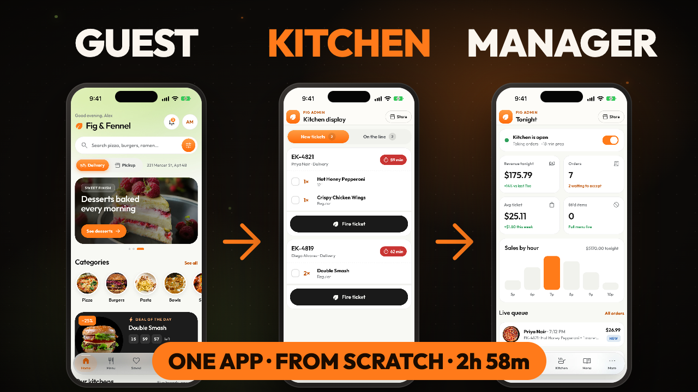

<p align="center">
  <a href="https://youtu.be/dRi0hSMB4r8"></a>
</p>

<h1 align="center">Fig &amp; Fennel: starter kit</h1>

<p align="center">
  Everything for the free course <b>Build a full restaurant app with Expo from scratch</b><br>
  iOS and Android · Expo SDK 58 · React Native · TypeScript · 2 h 58 min
</p>

<p align="center">
  <a href="https://youtu.be/dRi0hSMB4r8"><b>▶ Watch the course</b></a>
  &nbsp;·&nbsp;
  <a href="GUIDE.md"><b>📘 Read the guide</b></a>
  &nbsp;·&nbsp;
  <a href="https://buymeacoffee.com/reactbd/e/595519"><b>🚀 Get the full-stack edition</b></a>
</p>

---

In the course you build **Fig & Fennel** from an empty folder, typed live and explained line by line:
- a guest app;
- an account area;
- a whole manager's console, all in one Expo app.

This repository has everything you need along the way:

- **The starter pack:** the design prototype, the app icons and the splash badge you copy in chapter 1.
- **The finished app:** the complete source code of the course.
- **A checkpoint for every chapter:** the code exactly as it stands at the end of each chapter. Use it to check your work, catch up, or start in the middle.

## What's in this repository

| | What it is | When you need it |
| --- | --- | --- |
| [`starter-pack/`](starter-pack) | `design/`: the interactive prototype of every screen. `assets/`: the app icon, the three Android icon layers and the splash badge | **Chapter 1:** copy both folders into your new project |
| [`app/`](app) | The finished app, the way chapter 26 leaves it | To run it, or to compare with your own code |
| [Chapter tags](https://github.com/noorjsdivs/fig-app-starter-kit/tags) | `chapter-01` … `chapter-26`: the app at the end of each chapter | When you're stuck, or want to start mid-course |
| [`GUIDE.md`](GUIDE.md) | Set up your computer, follow along, use the checkpoints, fix common problems | **Before you start** |

## Start here

**Following the course?**

1. Get this repository: the green **Code** button → **Download ZIP**, or clone it:
   ```bash
   git clone https://github.com/noorjsdivs/fig-app-starter-kit.git
   ```
2. Read [**What you need**](GUIDE.md#1-what-you-need) in the guide. It's Node, VS Code, and Xcode or Android Studio.
3. Start the [**course**](https://youtu.be/dRi0hSMB4r8) at chapter 1 with an empty folder. The guide walks through [chapter 1](GUIDE.md#chapter-1-step-by-step) step by step.

**Just want to run the finished app?**

```bash
git clone https://github.com/noorjsdivs/fig-app-starter-kit.git
cd fig-app-starter-kit/app
npm install
npx expo run:ios          # or: npx expo run:android
```

The first run builds a development app, which takes a few minutes. Sign in with any email and password. The manager's
console is under **Profile → Restaurant admin**.

## The chapters

Each chapter links to its place in the video, to the code at its end, and to exactly what it changed.

| # | Chapter | Starts at | Code at the end | What changed |
| --- | --- | --- | --- | --- |
| ▶ | **Trailer:** what you'll build, the two editions, what you need | [0:00](https://youtu.be/dRi0hSMB4r8) | | |
| 1 | [An empty folder](https://youtu.be/dRi0hSMB4r8?t=714) | 11:54 | [chapter-01](https://github.com/noorjsdivs/fig-app-starter-kit/tree/chapter-01/app) | [diff](https://github.com/noorjsdivs/fig-app-starter-kit/compare/starter-pack...chapter-01) |
| 2 | [Design tokens, fonts and icons](https://youtu.be/dRi0hSMB4r8?t=1069) | 17:49 | [chapter-02](https://github.com/noorjsdivs/fig-app-starter-kit/tree/chapter-02/app) | [diff](https://github.com/noorjsdivs/fig-app-starter-kit/compare/chapter-01...chapter-02) |
| 3 | [The data model](https://youtu.be/dRi0hSMB4r8?t=1420) | 23:40 | [chapter-03](https://github.com/noorjsdivs/fig-app-starter-kit/tree/chapter-03/app) | [diff](https://github.com/noorjsdivs/fig-app-starter-kit/compare/chapter-02...chapter-03) |
| 4 | [One store for the whole app](https://youtu.be/dRi0hSMB4r8?t=1862) | 31:02 | [chapter-04](https://github.com/noorjsdivs/fig-app-starter-kit/tree/chapter-04/app) | [diff](https://github.com/noorjsdivs/fig-app-starter-kit/compare/chapter-03...chapter-04) |
| 5 | [UI kit: text, glass and controls](https://youtu.be/dRi0hSMB4r8?t=2370) | 39:30 | [chapter-05](https://github.com/noorjsdivs/fig-app-starter-kit/tree/chapter-05/app) | [diff](https://github.com/noorjsdivs/fig-app-starter-kit/compare/chapter-04...chapter-05) |
| 6 | [UI kit: images, motion, layout and overlays](https://youtu.be/dRi0hSMB4r8?t=2816) | 46:56 | [chapter-06](https://github.com/noorjsdivs/fig-app-starter-kit/tree/chapter-06/app) | [diff](https://github.com/noorjsdivs/fig-app-starter-kit/compare/chapter-05...chapter-06) |
| 7 | [The app shell and the glass tab bar](https://youtu.be/dRi0hSMB4r8?t=3436) | 57:16 | [chapter-07](https://github.com/noorjsdivs/fig-app-starter-kit/tree/chapter-07/app) | [diff](https://github.com/noorjsdivs/fig-app-starter-kit/compare/chapter-06...chapter-07) |
| 8 | [The dish card and quick add](https://youtu.be/dRi0hSMB4r8?t=3745) | 1:02:25 | [chapter-08](https://github.com/noorjsdivs/fig-app-starter-kit/tree/chapter-08/app) | [diff](https://github.com/noorjsdivs/fig-app-starter-kit/compare/chapter-07...chapter-08) |
| 9 | [The home screen](https://youtu.be/dRi0hSMB4r8?t=3957) | 1:05:57 | [chapter-09](https://github.com/noorjsdivs/fig-app-starter-kit/tree/chapter-09/app) | [diff](https://github.com/noorjsdivs/fig-app-starter-kit/compare/chapter-08...chapter-09) |
| 10 | [Menu, search, filters and saved dishes](https://youtu.be/dRi0hSMB4r8?t=4410) | 1:13:30 | [chapter-10](https://github.com/noorjsdivs/fig-app-starter-kit/tree/chapter-10/app) | [diff](https://github.com/noorjsdivs/fig-app-starter-kit/compare/chapter-09...chapter-10) |
| 11 | [The dish detail screen](https://youtu.be/dRi0hSMB4r8?t=4705) | 1:18:25 | [chapter-11](https://github.com/noorjsdivs/fig-app-starter-kit/tree/chapter-11/app) | [diff](https://github.com/noorjsdivs/fig-app-starter-kit/compare/chapter-10...chapter-11) |
| 12 | [The cart](https://youtu.be/dRi0hSMB4r8?t=4944) | 1:22:24 | [chapter-12](https://github.com/noorjsdivs/fig-app-starter-kit/tree/chapter-12/app) | [diff](https://github.com/noorjsdivs/fig-app-starter-kit/compare/chapter-11...chapter-12) |
| 13 | [Checkout, order placed and live tracking](https://youtu.be/dRi0hSMB4r8?t=5130) | 1:25:30 | [chapter-13](https://github.com/noorjsdivs/fig-app-starter-kit/tree/chapter-13/app) | [diff](https://github.com/noorjsdivs/fig-app-starter-kit/compare/chapter-12...chapter-13) |
| 14 | [Sign in, register and verify](https://youtu.be/dRi0hSMB4r8?t=5523) | 1:32:03 | [chapter-14](https://github.com/noorjsdivs/fig-app-starter-kit/tree/chapter-14/app) | [diff](https://github.com/noorjsdivs/fig-app-starter-kit/compare/chapter-13...chapter-14) |
| 15 | [Splash and onboarding](https://youtu.be/dRi0hSMB4r8?t=6089) | 1:41:29 | [chapter-15](https://github.com/noorjsdivs/fig-app-starter-kit/tree/chapter-15/app) | [diff](https://github.com/noorjsdivs/fig-app-starter-kit/compare/chapter-14...chapter-15) |
| 16 | [Profile, edit profile and settings](https://youtu.be/dRi0hSMB4r8?t=6443) | 1:47:23 | [chapter-16](https://github.com/noorjsdivs/fig-app-starter-kit/tree/chapter-16/app) | [diff](https://github.com/noorjsdivs/fig-app-starter-kit/compare/chapter-15...chapter-16) |
| 17 | [My orders, notifications and rating](https://youtu.be/dRi0hSMB4r8?t=6872) | 1:54:32 | [chapter-17](https://github.com/noorjsdivs/fig-app-starter-kit/tree/chapter-17/app) | [diff](https://github.com/noorjsdivs/fig-app-starter-kit/compare/chapter-16...chapter-17) |
| 18 | [Addresses and payment methods](https://youtu.be/dRi0hSMB4r8?t=7213) | 2:00:13 | [chapter-18](https://github.com/noorjsdivs/fig-app-starter-kit/tree/chapter-18/app) | [diff](https://github.com/noorjsdivs/fig-app-starter-kit/compare/chapter-17...chapter-18) |
| 19 | [Table bookings and Fig Club rewards](https://youtu.be/dRi0hSMB4r8?t=7729) | 2:08:49 | [chapter-19](https://github.com/noorjsdivs/fig-app-starter-kit/tree/chapter-19/app) | [diff](https://github.com/noorjsdivs/fig-app-starter-kit/compare/chapter-18...chapter-19) |
| 20 | [Help centre and the Fig Journal](https://youtu.be/dRi0hSMB4r8?t=8198) | 2:16:38 | [chapter-20](https://github.com/noorjsdivs/fig-app-starter-kit/tree/chapter-20/app) | [diff](https://github.com/noorjsdivs/fig-app-starter-kit/compare/chapter-19...chapter-20) |
| 21 | [The admin console and dashboard](https://youtu.be/dRi0hSMB4r8?t=8633) | 2:23:53 | [chapter-21](https://github.com/noorjsdivs/fig-app-starter-kit/tree/chapter-21/app) | [diff](https://github.com/noorjsdivs/fig-app-starter-kit/compare/chapter-20...chapter-21) |
| 22 | [Admin orders and the kitchen display](https://youtu.be/dRi0hSMB4r8?t=9079) | 2:31:19 | [chapter-22](https://github.com/noorjsdivs/fig-app-starter-kit/tree/chapter-22/app) | [diff](https://github.com/noorjsdivs/fig-app-starter-kit/compare/chapter-21...chapter-22) |
| 23 | [Admin menu, categories and kitchens](https://youtu.be/dRi0hSMB4r8?t=9414) | 2:36:54 | [chapter-23](https://github.com/noorjsdivs/fig-app-starter-kit/tree/chapter-23/app) | [diff](https://github.com/noorjsdivs/fig-app-starter-kit/compare/chapter-22...chapter-23) |
| 24 | [Admin home, journal and promotions](https://youtu.be/dRi0hSMB4r8?t=9750) | 2:42:30 | [chapter-24](https://github.com/noorjsdivs/fig-app-starter-kit/tree/chapter-24/app) | [diff](https://github.com/noorjsdivs/fig-app-starter-kit/compare/chapter-23...chapter-24) |
| 25 | [Admin customers, bookings, reviews and settings](https://youtu.be/dRi0hSMB4r8?t=10174) | 2:49:34 | [chapter-25](https://github.com/noorjsdivs/fig-app-starter-kit/tree/chapter-25/app) | [diff](https://github.com/noorjsdivs/fig-app-starter-kit/compare/chapter-24...chapter-25) |
| 26 | [Typed routes, checks and Android](https://youtu.be/dRi0hSMB4r8?t=10464) | 2:54:24 | [chapter-26](https://github.com/noorjsdivs/fig-app-starter-kit/tree/chapter-26/app) | [diff](https://github.com/noorjsdivs/fig-app-starter-kit/compare/chapter-25...chapter-26) |

## What you'll build

**The guest app**
- splash and onboarding;
- sign in, register and verify;
- Home, the menu with search and filters, saved dishes, the dish screen with sizes and extras;
- the cart with promo codes, checkout and live order tracking.

**The account:** profile, settings and dark mode, my orders, notifications and rating, addresses, a card wallet, table
bookings, Fig Club rewards, the help centre and the Fig Journal.

**The manager's console** (inside the same app):
- tonight's dashboard, orders and the kitchen display;
- the menu editor, categories and kitchens;
- the Home layout and banners, the journal, promotions;
- customers, bookings, reviews and settings.

**Under the hood:**
- one Zustand store for the whole app;
- a typed data model;
- a UI kit with glass, motion and sheets;
- Reanimated animations;
- typed routes;
- the same code running on Android.

## The stack

Expo SDK 58 · React Native 0.88 · React 19 with the React Compiler · TypeScript (strict) · Expo Router · Reanimated 4 ·
Zustand 5 · expo-image · expo-blur · expo-linear-gradient · react-native-svg · Outfit · Material Symbols Rounded

45 screens · about 15,200 lines of code · **no backend, no accounts, no keys, no paid services**. The food photos load
from Unsplash.

## 🚀 Want the full-stack edition?

The course builds the app on local data. The **full-stack edition** turns the same app into a real restaurant
platform:

- **Its own API:** Fastify 5 on Node, with a shared Zod contract, so the app and the server always agree on a total.
- **Real accounts:** Firebase sign-in with email, Apple and Google, plus verification and password reset.
- **Real payments:** Stripe card, Apple Pay and Google Pay, saved cards, and refunds on cancel.
- **Photo uploads:** ImageKit, from the menu editor.
- **The restaurant team:** front of house, kitchen, dispatch and courier queues, with roles and a full order timeline.
- **A setup guide** from a fresh computer to the App Store and Google Play. It runs locally in about 30 minutes.

<p>
  <a href="https://buymeacoffee.com/reactbd/e/595519"><b>Get the full-stack source code →</b></a>
</p>

## Need help?

1. Check the guide's [**Troubleshooting**](GUIDE.md#6-troubleshooting) section.
2. Compare your code with the chapter's checkpoint: the **What changed** link above shows every line the chapter added.
3. Still stuck? Comment on the [video](https://youtu.be/dRi0hSMB4r8) with the chapter number and what you see.

## License

[MIT](LICENSE). Use the code to learn, and in your own projects, personal or commercial.

The app's dependencies keep their own licenses:
- Expo, React Native, Zustand and Reanimated: MIT;
- Material Symbols: Apache 2.0;
- the Outfit typeface: SIL Open Font License 1.1.

The food photos load at runtime from Unsplash, under the [Unsplash License](https://unsplash.com/license).

## ReactBD

[YouTube](https://www.youtube.com/@reactjsbd) · [Medium](https://medium.com/@reactbd) · [reactbd.com](https://reactbd.com)

If the course helped you, a ⭐ on this repository helps other people find it.
